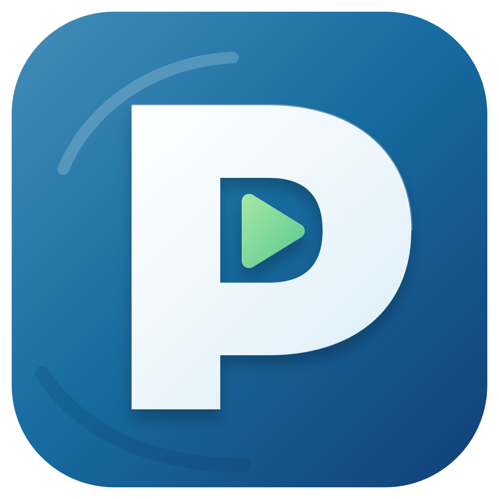

  
  <h1>PCL Mac CE</h1>
  

 

PCL Mac CE（社区版）是 [Plain Craft Launcher](https://github.com/Meloong-Git/PCL)（由 [龙腾猫跃](https://afdian.com/a/LTCat) 制作的 Minecraft 启动器）的**第三方** macOS 衍生作品：使用 SwiftUI 框架**完全重构**了 PCL 以支持 macOS。名称以 PCL 开头、以“Mac CE（社区版）”为第三方修改标识，符合《PCL 存储库合理使用指南》重度使用条款的命名要求。

> **维护状态**：原 PCL.Mac 项目（`CylorineStudio/PCL.Mac.Refactor`）已停止公开开发；现由 [**@JUANWANG-BUAA**](https://github.com/JUANWANG-BUAA) 接手独立维护并**持续开发**，基于原项目的 v1.1.1 代码基线，并更名为 **PCL Mac CE** 以与已停更的上游区分。本项目与 Cylorine Studio、PCL 官方均无隶属关系。

<table>
  <tr>
    <td></td>
    <td></td>
  </tr>
</table>

**请不要在 PCL 官方版本 / 其它衍生版相关仓库或群聊中反馈关于 PCL Mac CE 的问题。**

## 下载

项目发布页：[PCL Mac CE Releases](https://github.com/JUANWANG-BUAA/PCL-Mac-CE/releases)。首个版本尚未正式发布；正式下载仅以该页面的签名、公证安装包为准。

## 环境要求

|          |          最低           |    推荐     |
|:--------:|:-----------------------:|:-----------:|
| 普通使用 |       macOS 12.0        | macOS 14.0+ |
|   开发   | macOS 14.5 (Xcode 16) |      —      |

同时支持 Intel 与 Apple 芯片。

## 许可证
- PCL Mac CE 使用与 [PCL](https://github.com/Meloong-Git/PCL) 相同的许可证（见 `LICENSE`），并遵守其中关于“重度使用”的规定：关于页首位保留龙腾猫跃署名与赞助链接，已实现 Minecraft 正版购买动导，名称以 PCL 开头并带第三方标识（Mac CE）。
- PCLMacCE.Core（`PCLMacCE.Core/`）采用 MIT License 协议，使用其代码时请**保留许可证**及署名信息。
