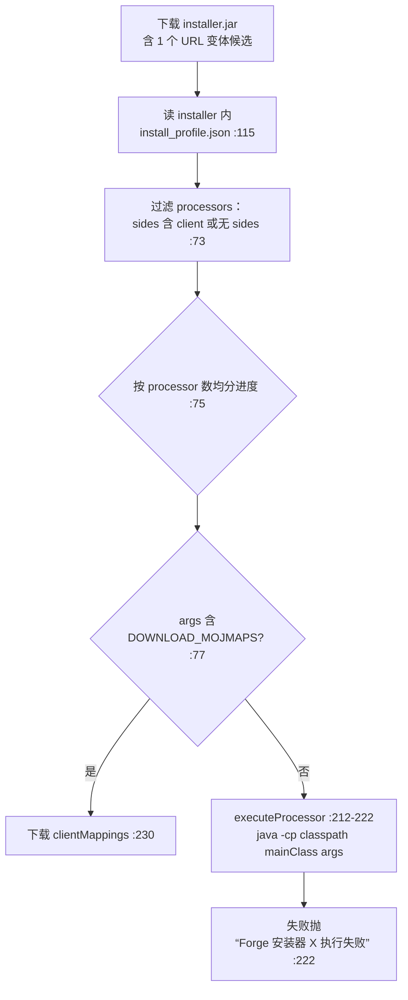

# Mod 平台与加载器

端点见[接口总表](inventory.md#4-mod-平台)。这一章讲安装与识别的实际行为。

## 加载器安装

### Fabric

下载 `meta.fabricmc.net/v2/versions/loader/{mc}/{loader}/profile/json` 得到的就是一份**完整客户端清单**，直接进 `ClientManifest` 解析流程（`Core/Task/MinecraftInstallTask.swift:403-408`）。

现状问题：这个 URL **写死官方域**，不在镜像改写表里，所以即使策略是 `mirrorFirst`，Fabric 的 profile 仍走境外；而它的**版本列表**（`DownloadSource.swift:49/81`）倒是可以走 bmclapi。列表能镜像、清单不能，是很反直觉的一处。

### Forge

`Core/Services/ForgeInstallService.swift`

要点：

- 安装器依赖库来自 install_profile 里的 maven artifact（`:204-205`）。
- `executeProcessor` 会**在本地用 java 执行第三方 jar 里的 mainClass**，classpath 由 `processor.classpath + processor.jar` 经 maven 坐标解析而来（`:213`），mainClass 从 jar 里读（`:214`，`Core/Utils/JarUtils.swift`），参数支持 `${...}` 占位符替换（`:215`）。
- 这是一条**任意代码执行面**：Forge 官方安装器可信，但同一套代码路径不校验 jar 签名，只按 maven 坐标下载。见[安全与健壮性发现](../risk/security-findings.md)。

### NeoForge

`Core/Services/NeoforgeInstallService.swift:12-18`，复用 Forge 的 install_profile 流程，只是 maven 根不同。**1.20.1 特例**：坐标落在 `net/neoforged/forge` 而非 `neoforged`。

## macOS natives 补丁

`Core/Utils/NativesMapper.swift` —— 老版本 MC 的 natives 不含 macOS arm64，这里手工注入 `lwjgl-glfw` / `objc-bridge` / `lwjgl2-natives` 等，从 **`repo1.maven.org`** 取（`:38,48,61,64`），默认 urlRoot 是 `libraries.minecraft.net/`（`:72`）。

作者自己在文件头留了话（`NativesMapper.swift:8-9`）：

> `// 直接从老项目里抄的`
> `// 这段代码现在只有上帝能看懂了.jpg`

这是全项目**唯一有明确作者自认不可维护**的模块，且它落在 `repo1.maven.org` 这条镜像漏网路径上。改造时如果要动 natives 逻辑，先补测试。

## Mod / 资源平台客户端

| 客户端 | 位置 | 鉴权 | 并发控制 |
|---|---|---|---|
| Modrinth | `Core/Services/ModrinthAPIClient.swift` | 无 | — |
| CurseForge | `Core/Services/CurseForgeAPIClient.swift` | `x-api-key` | `AsyncSemaphore(value: 8)`（`:12,39-40`） |

### 按哈希反查资源

`Core/Services/Resource/ResourceRemoteLookupService.swift` 把"我本地有个 jar，它是什么 Mod"这件事统一掉：

- 单个：`modrinthClient.version(ofHash:)` → 再取 project（`:20-23`）
- 批量：`modrinthClient.versions(ofHashes:)` → `projects(projectIds, revalidate: true)`（`:32-39`）
- Modrinth 查不到才落到 CurseForge（构造时 `curseforgeClient` **无默认值**，`:14`，说明调用方必须显式提供 key 环境）

现状结论：哈希反查**以 Modrinth 为主、CurseForge 为辅**，所以没配 CurseForge key 时批量识别仍大部分可用，只是 CurseForge 来源的 Mod 识别不出。

### 资源解析器

`Core/Services/Resource/` 下按类型分派：`ResourceParser.swift`（总入口）、`Parsers/ModParser.swift`（读 `mods.toml` → **TOMLDecoder**、`fabric.mod.json`）、`Parsers/ResourcepackParser.swift`、`Parsers/ShaderParser.swift`（`.txt` option 文件）、`ResourceLoadService.swift`（本地实例已装资源）。

## 整合包导入

| 元素 | 位置 | 说明 |
|---|---|---|
| 格式枚举 | `Core/Models/Modpack/ModpackIndex.swift:19-27` | 四种：`modrinth` / `curseforge` / `mcbbs` / `simple`（"包含 .minecraft 目录的压缩包"） |
| 各格式索引 | `Modpack/ModrinthModpackIndex.swift`、`Modpack/CurseForgeModpackIndex.swift` | — |
| 导入服务与任务 | `Core/Services/ModpackImportService.swift`、`Core/Task/ModpackImportTask.swift` | — |
| 拖拽入口 | `App/AppDelegate.swift` + `Managers/FileDropHandler.swift:20`、`Views/Launch/InstanceList/InstanceListSidebar.swift:50-85` | 支持拖入直接装到当前实例 |
| 压缩包能力 | ZIPFoundation；`Core/Extensions/Archive+EntryExtract.swift` | 7z/rar/tar 等格式的实际支持范围见[未确认清单](../risk/unverified.md) |

## 空 key 的现状行为（重要）

CurseForge key 缺失时**不会跳过请求**，而是把空字符串当 `x-api-key` 发出去：

- `App/AppDelegate.swift:69-71`
- `ViewModels/ModpackViewModel.swift:20-25`
- `Managers/FileDropHandler.swift:20`
- `ViewModels/Instance/InstalledResourcesViewModel.swift:39`

都是 `Secrets.shared.curseforgeApiKey ?? ""`。本地开发构建（没有 CI 注入的 `Secrets.properties`）**必然 403**，表现为"CurseForge 搜索/整合包导入失败"，但错误信息来自 CurseForge 而不是"你没配 key"。这是接手后第一个会踩的坑。
