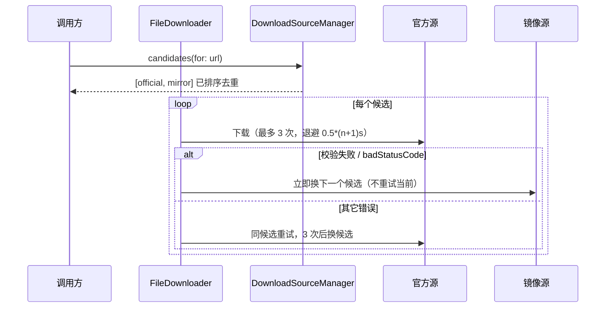

# 网络层与镜像源体系

v1.1.1 有**两套完全不同的网络通道**，理解这一点是理解所有下载/重试行为的前提：

| | API 通道 | 下载通道 |
|---|---|---|
| 实现 | `Core/Utils/HTTPClient.swift` | `Core/Services/Download/FileDownloader.swift` |
| session | `URLSession.shared`（`:129`） | 自建 session + `DownloadDelegate`（`:11-15`） |
| 重试 | **无** | 3 次，退避 `0.5*(n+1)` 秒（`:19,105`） |
| 换源 | 无 | 有，镜像候选列表 |
| 校验 | 无 | SHA-1/256/512 |
| 进度/限速 | 无 | `DownloadSpeedManager` + `ConcurrentProgressHandler` |

**后果**：清单、搜索、登录这类 API 请求对网络抖动**零容错**，一次失败直接冒到 UI；只有文件下载有韧性。

## HTTPClient 契约

```
request(url:method:headers:body:using:throwOnError:revalidate:timeout:)   // :80
get(...)   // :152  默认 timeout 30s
post(...)  // :172  默认 timeout 30s
```

行为细节（每条都会影响你加接口时的预期）：

| 行为 | 说明 | 行 |
|---|---|---|
| URL 抽象 | `URLConvertible`，`String` 与 `URL` 都可传 | `:11-24` |
| scheme 守卫 | 只允许 http/https，否则 `RequestError.invalidScheme`；**放行 http** | `:91-93` |
| User-Agent | 硬编码 `PCL-Mac/<CFBundleShortVersionString>`，且在 `allHTTPHeaderFields = headers` **之后**赋值 → 调用方无法覆盖 | `:101` |
| 缓存策略 | `revalidate: true` → `.reloadRevalidatingCacheData`（唯一用到 HTTP 条件请求语义的地方） | `:102-104` |
| GET 带 body | body 被当作 URL query 参数，覆盖 `queryItems` | `:98-104` |
| 编码 | 非 GET 时按 `.json` / `.urlEncoded`；`.urlEncoded` 是 `body.map{"\($0)=\($1)"}.joined("&")` —— **不做百分号转义** | `:110-125,183-190` |
| nil 值 | `compactMapValues` 剔除，键不会以空值发出 | `:96` |
| 响应头 | key 统一转小写 | `:60-66` |
| 错误 | `RequestError(invalidURL/invalidScheme/encodeError)` + `ResponseError(invalidType/badStatus/decodeError)`，中文 localizedDescription | `:195-244` |
| 非 2xx | **只有 `throwOnError: true` 才抛**，否则把 bad status 交给调用方自己判 | `:136-138` |
| 解码错误 | `DecodingError` 被包装成 `ResponseError(.decodeError)` → 上层 `catch let e as DecodingError` 的分支**永远进不去** | `:44-58` |
| 取消 | URLSession 的取消错误归一化为 `CancellationError()` | `:130-131` |

> `.urlEncoded` 不转义这一条已经在实际影响正版登录：`scope = "XboxLive.signin offline_access"` 里的**裸空格**被原样发进请求体（`MicrosoftAuthService.swift:28,92`），目前靠服务端容错才没出问题。

## FileDownloader 与候选源切换



关键实现：`FileDownloader.swift:51`（取候选）、`:74-95`（校验）、`:92-101`（换源判定）、`:105`（退避）、`:109`（穷尽候选后报错）、`:155-158`（`AsyncSemaphore` 并发闸）。

## 镜像源策略模型

| 元素 | 位置 |
|---|---|
| 协议 `DownloadSource`（4 个版本清单 URL + `candidate(for:)`） | `Source/DownloadSource.swift:20-32` |
| `OfficialDownloadSource`（Forge 列表返回 nil，官方无此能力） | `:35-59` |
| `MirrorDownloadSource`（BMCLAPI `:65`、MCIM `:66`） | `:62-128` |
| 策略枚举 `officialFirst` / `mirrorFirst` | `:10-15`，持久化在 `config.json` 的 `downloadSourcePolicy` |
| 管理器（持两源 + 全局 policy + 并发推荐） | `Source/DownloadSourceManager.swift:20-35` |

### 中国区判定的两阶段

1. **初值**：`Locale.current.identifier == "zh_CN"`（`DownloadSourceManager.swift:25`）——系统语言，启动即可用但可能不准。
2. **异步覆盖**：`AppDelegate.swift:78` 调 `refreshRegion()`，用 `www.cloudflare-cn.com/cdn-cgi/trace` 的 `loc=CN` 判定**公网出口**（`Core/Utils/LocaleUtils.swift:23-41`）。
3. **失败回退**：`isInChinaMainland(strict:)` 出错时返回 `!strict`。默认 `strict = true` → 视为"非中国"，偏保守；但更新流程用的是 `strict: false`（`Services/UpdateService.swift:69-70`）→ **判定失败时倾向走镜像**。

判定结果影响三处：镜像候选是否进入列表（`:54`）、推荐并发（`:30-35`）、版本清单/加载器列表 URL 二选一（`preferred(official:mirror:)` `:87-95`）。

### 候选排序与去重

`orderedCandidates`（`:52-61`）：官方恒在；`preferMirror ?? (policy == .mirrorFirst)` 决定 `[mirror, official]` 还是 `[official, mirror]`；然后 `Set<URL>` 顺序去重（镜像改写后可能与原 URL 相同）。

**版本列表类不是候选列表**：Forge/NeoForge/Fabric 的版本清单是 `preferred()` **二选一的单个 URL**（`:63-85`），没有"这个失败换那个"的能力。

### 并发上限

| 场景 | 值 | 行 |
|---|---|---|
| 官方源 | 64 | `:27` |
| 镜像源 | 16 | `:28` |
| assets 全量下载 | 硬编码 64 且 `preferMirror: false` | `Core/Task/MinecraftInstallTask.swift:295-303` |

## 镜像改写映射（`DownloadSource.swift:89-115`）

| 官方主机/前缀 | 改写为 |
|---|---|
| `piston-meta` / `piston-data` / `launchermeta` / `launcher.mojang.com` | `bmclapi2…/{path}` |
| `resources.download.minecraft.net` | `bmclapi2…/assets/{path}` |
| `libraries.minecraft.net`、`files.minecraftforge.net/maven`、`maven.neoforged.net/releases`、`maven.fabricmc.net`、`maven.minecraftforge.net` | `bmclapi2…/maven/{path}` |
| `meta.fabricmc.net` | `bmclapi2…/fabric-meta/{path}` |
| `cdn.modrinth.com`、`edge.forgecdn.net` | `mod.mcimirror.top` |

### 不在表里的下载点（现状漏网）

| 路径 | 影响 | 行 |
|---|---|---|
| `repo1.maven.org/maven2` | macOS natives 补丁，中国区仍走境外 maven | `Core/Utils/NativesMapper.swift:38,48,61,64` |
| Fabric `profile/json` | 写死官方域 | `Core/Task/MinecraftInstallTask.swift:403-408` |
| `authlib-injector.yushi.moe` 及其 jar | 第三方登录注入器 | `Task/MinecraftLaunchTask.swift:282-288` |
| 自更新包（github / mirror 两 URL） | 由 update.json 下发，不经改写表 | `Managers/UpdateManager.swift:30-36` |
| Java 运行时列表 `all.json` | 直接取官方，未经 `DownloadSourceManager` | `ViewModels/JavaSettingsViewModel.swift:34` |

## 本地缓存

| 数据 | 位置 | 失效方式 |
|---|---|---|
| 版本清单 | `~/Library/Application Support/PCL.Mac.Refactor/Caches/version_manifest.json` | 无 TTL；靠 HTTP revalidate + 内存单例比对（`Core/Models/VersionManifest.swift:104-116`） |
| 资源缓存 | `Core/Services/Cache/ResourceCache.swift` | — |
| authlib-injector.jar | `…/PCL.Mac/authlib-injector.jar` | 每次启动按 SHA 校验，不过则删并重下 |
