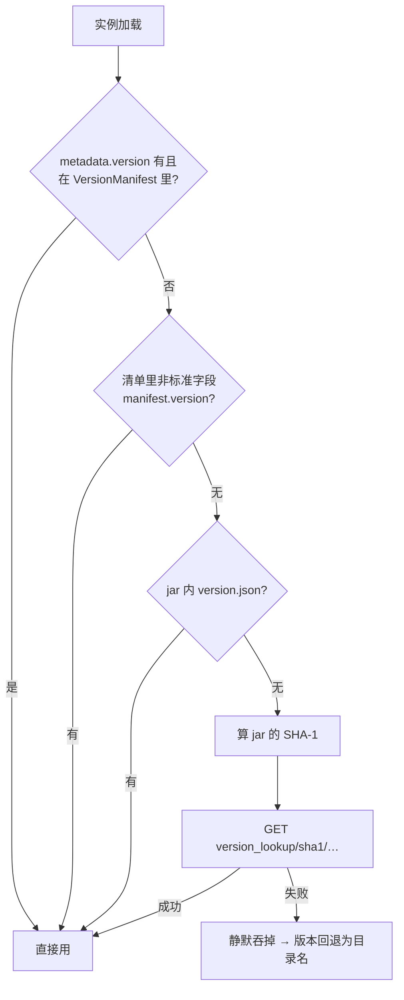

# 自有后端 cylorine.studio

上游作者自己维护的"后端"其实是**两个不同生命周期的东西**，这一点在改造时最容易搞混：

| | 地址 | 承载内容 | 现状 |
|---|---|---|---|
| GitHub Pages 站点 | `cylorine.studio` | 官网、帮助文档、头像、`meta/` 下的 JSON 数据（更新源、版本反查） | 🔴 **整站已删**，域名返回 GitHub Pages "Site not found"，`.github.io` 同样为空 |
| 独立后端 | `api.cylorine.studio` | 回声洞、EasyTier 节点与状态 | 🟡 **实测仍返回 200**，但属作者私有基础设施，随时可关 |

> 也就是说：主域已死、子域还活。你的启动器里"检查更新"必然失败，但"红石联机"目前还能用。

## 1. 自更新元数据 `update.json`

- 地址：`https://cylorine.studio/meta/PCL.Mac/update.json`（`Managers/UpdateManager.swift:14`，构造器可注入）
- 请求：`HTTPClient.get(..., revalidate: true)`（`:24`）
- 契约类型：`Models/UpdateModel.swift`，**合成 Codable、无 decodeIfPresent → 全部字段必填**，少一个键就整个解码失败

```
{
  "latestVersion": {
    "name": String,                    // 展示用版本名
    "bundleVersion": Int,              // 唯一比较依据（CFBundleVersion）
    "summary": String,                 // 更新摘要
    "updateLogLinks": [ { "name": String, "url": URL } ],
    "downloads": {
      "github": URL,                   // 主下载
      "mirror": URL,                   // 国内镜像下载
      "size": Int,                     // 字节数
      "sha1": String                   // 校验值
    }
  }
}
```

字段行号：`UpdateModel.swift:11-14`（Link）、`:18-21`（Downloads）、`:24-28`（Version）、`:31`（顶层）。

## 2. 版本反查 `version_lookup`

- 地址：`https://cylorine.studio/meta/mc/version_lookup/sha1/{sha1}`（`Core/Services/MinecraftInstanceLoader.swift:173`）
- 响应：`{"version": "..."}`，代码只取 `["version"]`（`:174`）
- **它是深度兜底，不是主路径**。调用链有四道门槛（`:154-179`）：



- 失败行为：`try?` / 空 `catch`（`:169,175`）→ 返回 nil → `warn("获取实例版本失败")`（`:67-69`）→ **实例仍然被构造**，版本号显示为目录名。
- 现状原因：作者用它来识别那些没有 `version.json`、清单里也没写 `version` 的非标准实例（典型是别人手工拷进来的、或老版本）。
- 注意 `:59-66` 的 `?? true`：`VersionManifest` 尚未加载时倾向认为"在清单里"，从而**跳过**反查。

## 3. CLAPI 三接口（`api.cylorine.studio`）

根地址唯一硬编码处：`Core/Services/CLAPIClient.swift:14`（`private let apiRoot`，`private init` → 不可注入）。

统一信封（`:39-67`）：

```
{ "code": Int, "msg": String, "data": JSON? }
```
`code != 0` → 抛 `apiError(code,msg)`；`data` 缺失 → 抛 `missingData`；HTTP 层 `throwOnError: true`。

| 端点 | 方法 | data 类型 | 消费方 |
|---|---|---|---|
| `/cave` | GET | `[String]` 回声洞台词 | `ViewModels/ToolboxViewModel.swift:36` |
| `/easytier/status` | GET | `{available: Bool, time: ISO8601 String, message: String}` | `ViewModels/MultiplayerViewModel.swift:160-161` |
| `/easytier/peers` | GET | `[String]` peer 地址 | `MultiplayerViewModel.swift:261-262` |

`/easytier/status` 的解析细节（`CLAPIClient.swift:21-31`）：`available == true` → `.available`；`false` 时把 `time` 按 ISO8601 解析，**解析失败抛 `responseFormatError`**，`message` 缺省为 `"无"` → `.unavailable(message:date:)`。

## 4. UI 层的站点依赖

| 用途 | 地址 | 行 |
|---|---|---|
| 作者/团队头像 | `cylorine.studio/img/avatar/{AnemoFlower,CylorineStudio}.png` | `Views/More/AboutPage.swift:20,25` |
| 官方网站入口 | `cylorine.studio`、`/projects/PCL.Mac.Refactor` | `AboutPage.swift:27,31`、`App/AppDelegate.swift:159` |
| 隐私政策 | `/privacy` | `AppDelegate.swift:162` |
| 联机帮助 | `/helps/PCL.Mac#multiplayer` | `Views/Multiplayer/MultiplayerPage.swift:139` |
| 光影教程 | `/helps/shader` | `Views/Download/ResourcesSearchPage.swift:22,24`、`Views/Launch/InstanceSettings/InstalledResourcesPage.swift:53,55` |
| README 用户群 | `/projects/PCL.Mac.Refactor#user_group` | `README.md:20` |

这些全是**点击才失败**或**图片加载失败静默留空**，不会崩，但用户看到的是一片 404。

## 5. 耦合点清单（改造时的最小替换面）

| 功能 | 唯一定义处 | 调用点 |
|---|---|---|
| 自更新 | `UpdateManager.swift:14`（URL）+ `UpdateManager.swift:24-36`（取数据与下载） | `Services/UpdateService.swift:16-76` |
| 版本反查 | `MinecraftInstanceLoader.swift:173`（内联字符串字面量） | 同文件 `:154-179` |
| 回声洞 | `CLAPIClient.swift:17-19` | `ToolboxViewModel.swift:36` |
| 联机状态 | `CLAPIClient.swift:21-31` | `MultiplayerViewModel.swift:160-161` |
| 联机节点 | `CLAPIClient.swift:33-35` | `MultiplayerViewModel.swift:261-262` |

现状特征：

> **2026-10-14 改造后**：三处根地址已集中到 `Core/Utils/APIEndpoints.swift`（`CylorineAPI.root` / `CylorineSite.launcherUpdate` / `CylorineSite.versionLookup(sha1:)`），换后端只需改这一个文件。

- **只有 `UpdateManager` 的 URL 可以通过构造器注入**；`CLAPIClient` 是 `private init` + `private let apiRoot`，`version_lookup` 是内联字面量——这两处要换必须改源码。
- 三处都**没有配置开关、没有环境变量、没有 feature flag**（`Managers/FlagsManager.swift:60-63` 只有 `deduplicateLibraries` 和 `multiplayer` 两个 flag）。
- 全部走 `HTTPClient`，因此**无重试**；`/cave` 失败会让百宝箱页面报错，`/easytier/peers` 失败则提示后返回空数组（`MultiplayerViewModel.swift:270-282`）。
