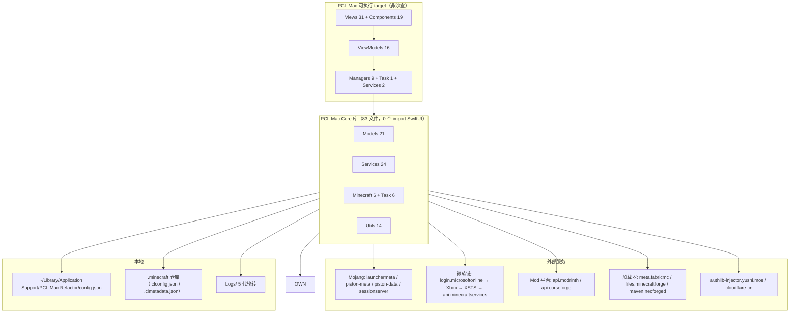

# 系统概览与分层

## 一句话

单进程 macOS 应用（非沙盒、无 XPC、无本地服务）：**SwiftUI 前端 + 一个零 UI 依赖的 Core 库 + 一堆外部 HTTP 服务**。所谓"后端"只有作者自己的 `cylorine.studio` / `api.cylorine.studio`，其余全部是 Mojang、微软、Mod 平台与社区镜像源。

## 系统上下文

## 分层事实

| 层 | 路径 | Swift 文件 | 硬约束 |
|---|---|---|---|
| 业务/模型库 | `PCL.Mac.Core/` | 83 | **零 `import SwiftUI`**（实测），可脱离 App 单测；单独 MIT 许可 |
| 应用层 | `PCL.Mac/` | 95 | Views 31 / Components 19 / ViewModels 16 / Managers 9 / App 7 / Models 7 / Services 2 / Task 1 / Extensions 3 |
| 测试 | `PCL.Mac.Tests/` | 8 | 285 行、11 个用例；部分用例会打真实网络 |

> Core 与 App **两侧都有** `Managers/`、`Task/`、`Services/`、`Extensions/` 同名目录。找代码时必须先看属于哪个 target，这是现状里最容易踩的导航坑。

## 状态与数据流

- **UI 状态**：MVVM + `ObservableObject` + `@Published`，没有 Redux 式单向流，没有路由状态机（`AppRouter.shared` 直接持有当前页面）。
- **全局状态**：靠单例，20+ 个 `static let shared`。其中 `VersionManifest.shared` 与 `FlagsManager.shared` 是**可变的全局变量**（`AppDelegate.swift:73` 就地重建 FlagsManager），不是不可变单例。
- **持久状态**：唯一真相是 `config.json`（`LauncherConfig.shared`，15 个字段，见[配置持久化](run/persistence.md)）。**运行期改内存、退出时才落盘**（`AppDelegate.swift:183-186`）。
- **实例状态**：不写在 config.json 里，而是散在 `.minecraft` 各版本目录的 `.clconfig.json` / `.clmetadata.json`。

## 关键架构模式（以及它为什么长这样）

| 模式 | 现状 | 现状原因 |
|---|---|---|
| 单例网络层 | `HTTPClient.shared` 走 `URLSession.shared`，**无重试**，超时由调用方传（默认 30s） | 清单/搜索类小请求，作者只做了"能跑"的封装 |
| 双轨下载 | 大文件走 `FileDownloader`：自建 session + 3 次退避重试 + 镜像候选切换 | 中国大陆下载体验是硬需求（#214） |
| 判别式编解码 | `AccountWrapper{type, account}`，`type` 是兄弟字段；运行时 `is` 链判定，兜底 `fatalError()` | 三个账号类是 `class` 而非协议关联类型，Swift 无法自动多态编解码 |
| class 模型 + 引用语义 | `accounts` 数组存引用，token 原地 mutate | 省拷贝，代价是**不触发 UI 刷新**、且只在退出时持久化 |
| 任务管线 | `MinecraftLaunchTask` 分步执行（刷新账号是第 2 步），`TaskManager` 统一管进度与取消 | 启动是多阶段长任务，需要可取消与可视进度 |
| 无 base URL 注册表 | HTTP 根地址散落在 20+ 文件里，同域名字面量重复（`launchermeta` 3 次、`cylorine.studio` 3 次、`api.minecraftservices` 2 次） | 迭代中随手写；`URLConstants.swift` 名字误导，里面**全是本地文件路径**，一个 URL 都没有 |

## 两条影响全局的"现状决定"

1. **ATS 全局放行**：`PCL.Mac/Info.plist:7-11` 设 `NSAllowsArbitraryLoads = true`。
   原因：要兼容用户自建的明文 `http://` Yggdrasil 验证服务器（`AccountViewModel.swift:241` 显式允许 http）。
   代价：整个 app 失去 TLS 强制，包括微软登录与 Modrinth 请求在内的所有连接都不再被系统兜底。
2. **关闭沙盒**：`PCL.Mac/PCL_Mac.entitlements:5-6` `com.apple.security.app-sandbox = false`（另有 `audio-input = true`）。
   原因：要直接读写用户任意位置的 `.minecraft`、Java 安装目录、以及替换自身 `.app` 完成自更新。
   代价：`config.json` 里的明文令牌对同用户任意进程可读，见[Token 存储](auth/token-storage.md)。

## 相关章节

[模块清单](modules.md) · [技术栈与依赖](tech-stack.md) · [接口总表](../api/inventory.md)
