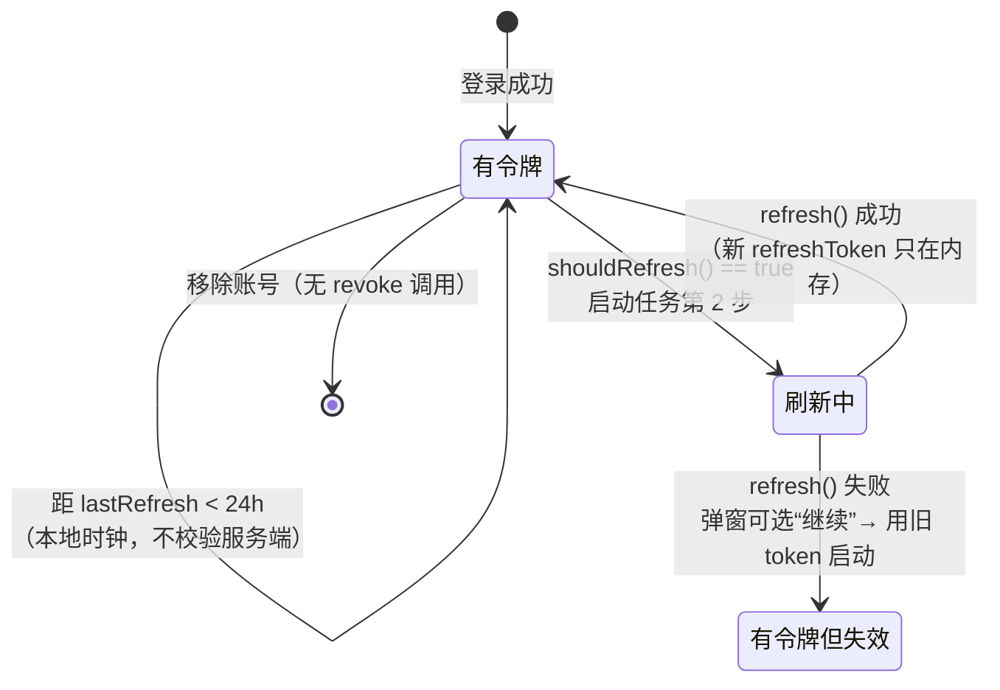

# Token 存储与生命周期

这一章集中回答"关键请求 token 到底在哪"。**结论先行：全部明文存在一个 JSON 文件里，没有钥匙串。**

## 存储位置

```
~/Library/Application Support/PCL.Mac.Refactor/config.json
```

- 路径定义：`Core/Utils/URLConstants.swift:14`（`applicationSupportURL`）、`:16`（`configURL`）
- 写出：`App/LauncherConfig.swift:113-116`，`JSONEncoder.shared.encode(config)` → `Data.write(to:)`
- **无文件权限收紧、无加密、无 `NSFileProtection`**
- 损坏时自动备份到 `config.bak.json`（`:28-38`，备份路径 `:46`）

### 为什么不是钥匙串

全仓库对 `SecItem` / `kSecClass` / `Keychain` 的引用数为 **0**；`PCL.Mac/PCL_Mac.entitlements` 只有两项：

```xml
<key>com.apple.security.app-sandbox</key><false/>
<key>com.apple.security.device.audio-input</key><true/>
```

没有 keychain-groups、没有 app group。加上沙盒关闭，`config.json` 就是一个**同用户任意进程可直接读取**的普通文件。

> 网上能搜到的"PCL macOS 移植版把令牌存进钥匙串 / 有访客模式与信任模式 / 可切换到本机加密文件"，说的是**另一个同名项目**（白枫的独立移植版，后改名 Bug Craft Launcher）。不要拿那些描述理解本仓库。

## 每种凭据的落点

| 凭据 | 属于 | 字段 | 是否落盘 | 是否加密 | 行 |
|---|---|---|---|---|---|
| Microsoft OAuth `access_token` | 正版 | 仅内存 `oAuthToken` | 否 | — | `Core/Services/MicrosoftAuthService.swift:16` |
| Microsoft `refresh_token` | 正版 | `MicrosoftAccount.refreshToken` | **是** | 否 | `Core/Models/Account/MicrosoftAccount.swift:13`，`CodingKeys:18` |
| Minecraft `access_token` | 正版 | `MicrosoftAccount.accessToken` | **是** | 否 | `:12` |
| `lastRefresh` | 正版 | `MicrosoftAccount.lastRefresh` | 是（只是时间戳） | — | `:14` |
| XBL / XSTS Token | 正版 | 函数局部变量 | 否 | — | `MicrosoftAuthService.swift:159-198` |
| Yggdrasil `accessToken` | 第三方 | `YggdrasilAccount.accessToken` | **是** | 否 | `YggdrasilAccount.swift:18` |
| Yggdrasil `clientToken` | 第三方 | `YggdrasilAccount.clientToken` | **是** | 否 | `:19` |
| Yggdrasil 服务器 URL | 第三方 | `authServerURL` | 是 | — | `:14` |
| ALI metadata（Base64） | 第三方 | `cachedMetadata` | 是 | — | `:16` |
| **Yggdrasil 密码** | 第三方 | 不存字段 | **否** | — | 只在 VM 内存 `AccountViewModel.swift:32-34` |
| 离线 accessToken | 离线 | computed var，每次新随机 UUID | 否 | — | `OfflineAccount.swift:19-21` |
| CurseForge API Key | 应用 | `Resources/Secrets.properties` 或环境变量 `PCLMAC_CURSE_FORGE_API_KEY` | 是（**随 `.app` 打包**） | 否 | `App/Secrets.swift:19-30`、`project.pbxproj:100-103` |
| Microsoft client ID | 应用 | 硬编码字面量 | 在源码里 | — | `MicrosoftAuthService.swift:14` |

## 生命周期一览



要点：

- 正版**没有任何服务端有效性探测**，判据只有 `Date.now - lastRefresh >= 86400`（`MicrosoftAccount.swift:38-40`）。
- 第三方**有**探测（`YggdrasilAccount.swift:49-51` → `POST /authserver/validate`，只认 204）。
- 移除账号（`AccountViewModel.swift:72-82`）**不调用任何撤销端点**：全仓库没有 `/oauth2/v2.0/revoke`、没有 signout。refresh_token 只是本地丢弃，微软侧授权仍然有效，需要用户自己去 account.live.com 撤。

## 落盘时机（这是最容易丢凭据的地方）

`LauncherConfig.save()` 全仓库**只有一处调用**：`App/AppDelegate.swift:183-186`（`applicationWillTerminate`）。

后果链：

1. 新登录的 token、轮转后的新 refresh_token 都只在内存；
2. 崩溃 / `kill -9` / 强制退出 → 本次登录全部丢失；
3. 正常退出后拿到的是**上一次**的 refresh_token；
4. 账号是 class 且 `@Published accounts` 存引用（`AccountViewModel.swift:14`），token 原地 mutate **不触发 UI 刷新**。

## 凭据外泄面清单

| # | 面 | 说明 | 行 |
|---|---|---|---|
| 1 | 明文 `config.json` | 见上 | `LauncherConfig.swift:113-116` |
| 2 | 启动参数日志 | 脱敏只做**逐项等值替换** `$0 == options.accessToken ? "🥚" : $0`；token 作为子串的参数不会被遮蔽；且 `-javaagent:…=<authServerURL>` 与 `-Dauthlibinjector…=<base64>` **全文入日志** | `Core/Minecraft/Launch/MinecraftLauncher.swift:74`、`:61-62` |
| 3 | 日志三重出口 | 写文件（`LogManager.swift:51-59`，保留 5 代 `Log1-5.log`）、INFO 级 `print` 到 stdout（`:48`）、WARN/ERROR 进 `os.Logger`（`:45-46`） | — |
| 4 | 一键导出 | 设置页导出日志 → `~/Desktop/PCL.Mac-logs-*.zip`（`ViewModels/SettingsViewModel.swift:21-25`）；崩溃报告含游戏原始终出（`Managers/MinecraftLaunchManager.swift:120-153`） | — |
| 5 | UI 主动放大 | 界面反复教育用户"把完整日志发给他人"（`AccountViewModel.swift:186,199`、`MinecraftLaunchTask.swift:148,167`）→ 与 2/3 叠加 | — |
| 6 | 原始响应体进 UI 与日志 | 非 JSON 响应体整段塞进 `apiError` 文案（`YggdrasilService.swift:225-228`），再经弹窗 + `log()` 落盘（`AccountViewModel.swift:301-308`）→ 被劫持的验证服务器可做**日志换行注入**与文案仿冒 | — |
| 7 | 微软错误分支同样回显响应 | `MicrosoftAuthService.swift:152-154` 把整个响应体写进 `err()`，`:144-146` 把 `error_description` 写日志，`AccountViewModel.swift:178-182` 弹窗显示"响应体：…" | — |
| 8 | 明文传输 | ATS 全局放行（`Info.plist:6-10`）+ 代码显式允许 http（`AccountViewModel.swift:241`）→ 密码与 accessToken 可走明文链路（`YggdrasilService.swift:47-49,77-79,104-111`） | — |
| 9 | ALI 头可静默改走凭据端点 | 服务端返回的 `x-authlib-injector-api-location` 可以是**任意绝对 URL**（含跨主机、含降级 http），添加账号时一次性永久固化（`YggdrasilService.swift:26-28`、`AccountViewModel.swift:260-264,289`） | — |
| 10 | 档案从不验签 | `fullProfile` 用 `unsigned=true`（`YggdrasilService.swift:160-162`），`Property.signature` 解析了但从未使用（`PlayerProfile.swift:47`） | — |
| 11 | key 随包分发 | `Resources/Secrets.properties` 整体进 bundle → 成品 `.app` 内可直接读出 CurseForge key | `project.pbxproj:100-103` |

## 密码处理的一个不对称

清理明文密码只发生在**成功路径**：`AccountViewModel.swift:297-299`；失败分支 `:301-309` **不清理** → 登录失败后明文密码持续驻留 VM 与输入框。
