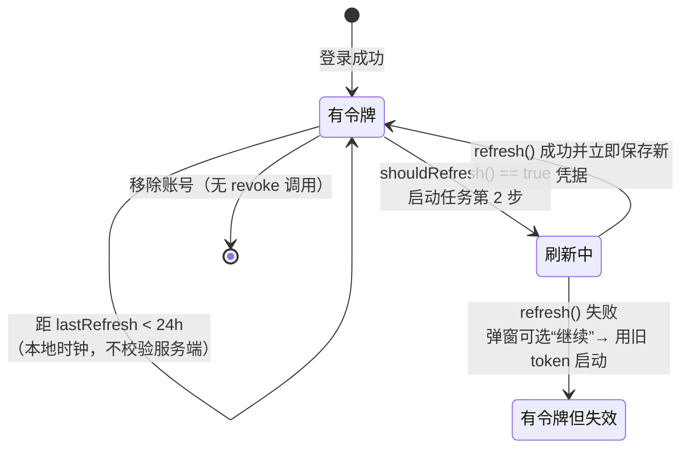

# Token 存储与生命周期

这一章集中回答关键请求 token 的落点。正常路径使用 macOS Keychain；Keychain 不可用时，应用会写入同目录下权限为 `0600` 的应急 JSON 文件，并在下次启动时重试迁移。

## 存储位置

```
~/Library/Application Support/PCLMacCE/config.json
```

- 路径定义：`Core/Utils/URLConstants.swift:14`（`applicationSupportURL`）、`:16`（`configURL`）
- 写出：`App/LauncherConfig.swift`；配置 JSON 不包含账号 token
- Keychain 不可用时写入 `config.tokens.json`，并对配置、应急文件和损坏配置备份设置 `0600`
- 损坏时先备份原文件；无法备份时禁止自动覆盖

### Keychain 与迁移

`Core/Utils/AccountTokenStore.swift` 提供 Keychain 与内存实现。账号加入或更新后立即保存凭据；Keychain 写入失败时将凭据暂存为权限 `0600` 的应急文件，启动后尝试回写 Keychain。旧版本保存在 `config.json` 中的明文 token 会迁移到 Keychain，并触发配置重写。

应急文件仍是明文；`0600` 只限制其他本机用户，不能阻止同一用户运行的恶意进程读取。它是 Keychain 不可用时的保全路径，不等同于加密存储。

## 每种凭据的落点

| 凭据 | 属于 | 字段 | 是否落盘 | 是否加密 | 行 |
|---|---|---|---|---|---|
| Microsoft OAuth `access_token` | 正版 | 仅内存 `oAuthToken` | 否 | — | `Core/Services/MicrosoftAuthService.swift` |
| Microsoft `refresh_token` | 正版 | Keychain；不可用时权限 `0600` 的应急文件 | 是 | Keychain / 应急明文 | `Core/Models/Account/MicrosoftAccount.swift` |
| Minecraft `access_token` | 正版 | Keychain；不可用时权限 `0600` 的应急文件 | 是 | Keychain / 应急明文 | 同上 |
| `lastRefresh` | 正版 | `MicrosoftAccount.lastRefresh` | 是（只是时间戳） | — | `:14` |
| XBL / XSTS Token | 正版 | 函数局部变量 | 否 | — | `MicrosoftAuthService.swift:159-198` |
| Yggdrasil `accessToken` | 第三方 | Keychain；不可用时权限 `0600` 的应急文件 | 是 | Keychain / 应急明文 | `YggdrasilAccount.swift` |
| Yggdrasil `clientToken` | 第三方 | Keychain；不可用时权限 `0600` 的应急文件 | 是 | Keychain / 应急明文 | 同上 |
| Yggdrasil 服务器 URL | 第三方 | `authServerURL` | 是 | — | `:14` |
| ALI metadata（Base64） | 第三方 | `cachedMetadata` | 是 | — | `:16` |
| **Yggdrasil 密码** | 第三方 | 不存字段 | **否** | — | 只在 VM 内存 `AccountViewModel.swift:32-34` |
| 离线 accessToken | 离线 | computed var，每次新随机 UUID | 否 | — | `OfflineAccount.swift:19-21` |
| CurseForge API Key | 应用 | 设置页本地文件、环境变量，或仅注释的包内模板 | 是 | 本地文件权限 `0600`；环境变量依赖调用方 | `App/Secrets.swift`；Release CI 不注入 Key |
| Microsoft client ID | 应用 | 默认公共 ID；可由本机配置或环境变量覆盖 | 在源码或本机配置 | — | `MicrosoftAuthService.swift`、`App/Secrets.swift` |

## 生命周期一览



要点：

- 正版刷新触发仍由 `Date.now - lastRefresh >= 86400` 决定；刷新成功后立即保存新凭据。
- 第三方**有**探测（`YggdrasilAccount.swift:49-51` → `POST /authserver/validate`，只认 204）。
- 移除账号（`AccountViewModel.swift:72-82`）**不调用任何撤销端点**：全仓库没有 `/oauth2/v2.0/revoke`、没有 signout。refresh_token 只是本地丢弃，微软侧授权仍然有效，需要用户自己去 account.live.com 撤。

## 落盘时机（这是最容易丢凭据的地方）

`LauncherConfig.save()` 在账号变更后立即调用，并在应用退出时再次保存。

账号增删、切换和微软令牌刷新后都会立即保存；应用退出时还会保存配置与实例。Keychain 写入失败时退回应急文件，并在下次启动时尝试迁移。保存失败会记录错误并提示用户，未保存的普通设置变更仍可能在异常退出时丢失。

## 凭据外泄面清单

| # | 面 | 说明 | 行 |
|---|---|---|---|
| 1 | Keychain 不可用时的应急文件 | `config.tokens.json` 是明文，但权限为 `0600`；同一 macOS 用户下的恶意进程仍可读取 | `App/LauncherConfig.swift` |
| 2 | 游戏原始日志 | 游戏进程输出由启动器保存并可导出；是否包含敏感信息取决于 Minecraft 版本或模组，分享前应检查 | `Core/Minecraft/Launch/MinecraftLauncher.swift` |
| 3 | 第三方认证传输 | 仍允许用户选择 HTTP Yggdrasil 服务；账号凭据可能经明文链路传输 | `ViewModels/AccountViewModel.swift`、`Core/Services/YggdrasilService.swift` |
| 4 | 认证端点重定向 | 跨主机或 HTTPS 降级会要求确认；同主机的路径、端口仍由服务端提供 | 同上 |
| 5 | CurseForge Key 分发 | **已修复**：Release CI 不注入 Key，并在打包前检查应用模板；真实 Key 只由用户保存在本机配置 | `.github/workflows/build.yml`、`.github/workflows/release.yml` |

Yggdrasil 登录密码只保存在 ViewModel 内存，并在请求完成后清除（成功或失败都会执行 `defer`）。
