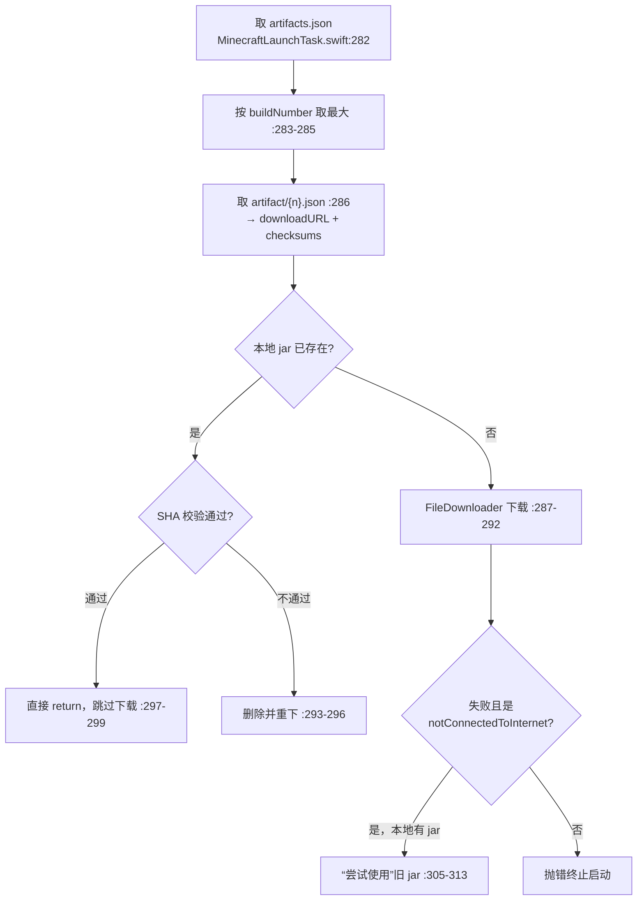

# 第三方与离线登录

## 第三方（Yggdrasil / authlib-injector）

### 输入与校验

UI 在 `Views/Launch/LaunchSidebar.swift:242-273`（三个字段，密码走 `secure: true` → `SecureField`，`Components/MyTextField.swift:27`），状态存 `ViewModels/AccountViewModel.swift:32-34`。

校验逻辑 `AccountViewModel.swift:235-257`：

1. 去空白后 `URL(string:)` 失败即报错（`:236-239`）；
2. 有 scheme 时只允许 `https` / `http`（`:240-244`）——**http 被显式放行**；
3. 无 scheme 时补 `https://`（`:246-250`）；
4. 用户名/密码仅校验非空（`:254-257`）。

**没有**主机白名单、没有重复账号检查、没有端口/路径合法性检查。

### ALI 头自动发现

`Core/Services/YggdrasilService.swift:22-35`：发 `HEAD /`，读响应头 `x-authlib-injector-api-location`（头名已统一小写，见 `Core/Utils/HTTPClient.swift:60-66`）。

- 值是绝对 `http`/`https` URL → **整体替换** `authServerURL` 并返回（`:26-28`）；
- 否则当相对路径 `appending(path:)`（`:30-31`）；
- 无该头 → 原样返回（`:34`）。

调用时机：**只在添加账号时**（`AccountViewModel.swift:260-264`），解析结果永久写进账号对象（`:289`）。启动与刷新阶段不再重跑 ALI（`YggdrasilAccount.swift:17` 直接用存量 URL 建 service）。

### 三个认证端点

| 动作 | 行 | 请求体 | 错误语义 |
|---|---|---|---|
| `authenticate` | `YggdrasilService.swift:44-64` | `POST /authserver/authenticate`，`username`、**明文 `password`**、`requestUser:true`、`agent{name:"Minecraft",version:1}`（`:47-55`） | 非 2xx → `apiError(error,errorMessage,cause)`（`:217-222`） |
| `validate` | `:73-89` | `POST /authserver/validate`，`accessToken` + `clientToken`（nil 值被 `compactMapValues` 剔除） | **只有 `statusCode == 204` 算有效**（`:82`）；`ForbiddenOperationException` → **返回 false 而不抛错**（`:84-86`） |
| `refresh` | `:99-126` | `POST /authserver/refresh`，`accessToken`、`clientToken`、`requestUser:true`、`selectedProfile`（`:104-112`） | 响应 `clientToken` 与原值不一致 → 抛"颁发的新令牌的 clientToken 与原令牌的不同。"（`:116-120`） |

统一错误映射 `:210-231`：非 2xx 优先解析 JSON 的 `error/errorMessage/cause`；**解析不出来则把原始响应体全文塞进错误消息**（`:225-228`）。

`clientToken` 由服务端在 authenticate 响应里下发（`:188-193`），客户端不生成；用于 validate/refresh 绑定令牌族；与 accessToken 一同明文落盘（`YggdrasilAccount.swift:21-23`）。

> refresh 有个现状缺陷：服务端若下发新 `clientToken`，代码只校验相等、**不回存**（`YggdrasilAccount.swift:40-47` 只更新 accessToken/profile）。

### metadata 缓存

- 写入：`YggdrasilAccount.swift:53-57`（`fetchMetadata()` 成功后存 Base64 串；Base64 编码发生在 `YggdrasilService.swift:144`）。
- 消费：仅启动流程 `Task/MinecraftLaunchTask.swift:269-278` —— 先实时拉，失败回退缓存，**无缓存则直接抛错终止启动**（`:274`）。
- 添加账号时**不预热缓存**（`AccountViewModel.swift:284` 只用 `serverMetadata.serverName`）→ 新第三方账号首次启动必须联网。
- **无 TTL、无失效逻辑**，每次成功覆盖（`YggdrasilAccount.swift:55`）。

### authlib-injector.jar 的获取与校验

`Task/MinecraftLaunchTask.swift:261-314`，仅当 `model.account is YggdrasilAccount` 才执行（`:262-264`）。

校验实现 `Core/Utils/FileUtils.swift:52-64`：只识别 `sha1`/`sha256`/`sha512` 三个键（`:54-57`），逐个比对，任一不符即 false（`:61`）。

两个必须知道的降级路径：

1. **未知算法键被 `continue` 静默跳过**（`:58,:60`）→ 若服务端只给未知算法，等价于"校验通过"。
2. `checksums == nil` 时 `check()` **直接返回 true**（`:67`）。

好消息：`authlib-injector.yushi.moe` **不在镜像改写表里**（`Core/Services/Download/Source/DownloadSource.swift:89-115`），所以 jar 与它的 checksums 始终来自同一个官方域，这条链路的完整性设计是对的。

JVM 侧落地见[游戏启动流程](../run/launch-flow.md)：`Core/Minecraft/Launch/MinecraftLauncher.swift:58-64`，三者齐备才加 `-javaagent` 与 `-Dauthlibinjector.yggdrasil.prefetched`。

## 离线账号

| 项 | 现状 | 行 |
|---|---|---|
| 玩家名规则 | **只有提示，没有任何校验**。v1.1.1 的改动（提交 `0297f9f` #242）只是把对话框标题改成"输入玩家名（只能包含字母、数字和下划线）" | `AccountViewModel.swift:313` |
| 输入防护 | `requestAddOfflineAccount`（`:312-320`）除"用户取消"外**无 guard**；输入框对空串也放行确定按钮（`Views/MessageBoxView.swift:93-100`）→ 可创建空名/含空格/超长/重名账号 | — |
| `accessToken` | **每次读取返回一个全新随机 UUID**（无横线），不持久化、与身份无关 | `OfflineAccount.swift:19-21` |
| 服务端交互 | 无。`refresh()` 空实现（`:23`）、`shouldRefresh()` 恒 false（`:25`）→ 启动流程对离线账号零网络请求 | — |
| UUID 推导 | 本地 MD5（Bukkit 风格） | `Core/Utils/UUIDUtils.swift:57-67` |
| 皮肤 | `properties` 恒 `[]` → 走内置默认位图 | `OfflineAccount.swift:15`、`AccountViewModel.swift:86-90` |
| 披风 | 明确拒绝，仅 `MicrosoftAccount` 可用 | `Services/CapeSelection.swift:15-17` |

附带影响：离线与第三方账号也受"正版验证"预检影响（`MinecraftLaunchTask.swift:194-236`）——中国大陆 IP 按 `launchCount` 白嫖次数弹提示（`:200-214`），非大陆 IP 可被切为**试玩模式** `options.demo = true`（`:228-230`）。

## 死代码：四处永远不会命中的 catch

`authenticate`（`YggdrasilService.swift:60-63`）、`refresh`（`:122-125`）、`fetchMetadata`（`:146-148`）、`fullProfile`（`:165-167`）各有一处 `catch let error as DecodingError`，**永远进不去**——因为 `HTTPClient.Response.decode/json()` 已经把 `DecodingError` 包装成 `ResponseError(.decodeError)`（`Core/Utils/HTTPClient.swift:44-58`）。

后果：服务端返回结构不符时，用户只看到"解码响应体失败。"，真实原因连 `debug()` 都不落日志。排查第三方登录问题时会非常难受。
