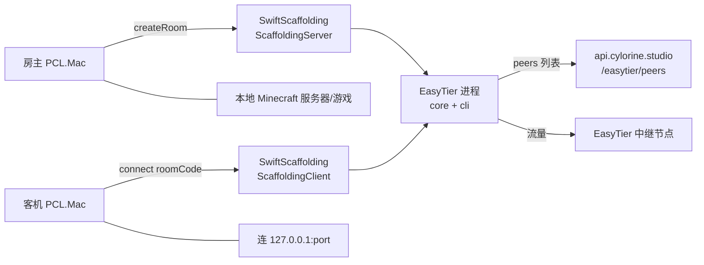

# 联机与 EasyTier

"红石联机"是三层拼起来的：**EasyTier（P2P 组网）+ SwiftScaffolding（Scaffolding-MC 协议）+ 作者后端（节点与状态）**。



## 依赖的外部二进制与库

| 组件 | 来源 | 固定方式 |
|---|---|---|
| `easytier-core` / `easytier-cli` v2.5.0 | `gitee.com/yizhimcqiu/easytier-mirror`（**第三方搬运**，非 EasyTier 官方） | URL 写死版本 + **SHA-1 硬编码在源码**（`Managers/EasyTierManager.swift:31,36,44,49`），arm64 与 x86_64 各一份 |
| SwiftScaffolding 0.2.0 | SPM，`CylorineStudio/SwiftScaffolding`（作者自己的库，**仍是公开仓库**） | 其信令后端主机在本仓库不可见 → [未确认](../risk/unverified.md) |

安装与检测（`EasyTierManager.swift`）：装到 `…/PCL.Mac.Refactor/EasyTier/`（`:16-17`，路径常量 `Core/Utils/URLConstants.swift:20`），下完 `chmod 0o755`（`:127,131`），`isInstalled` = 可执行 **且** SHA 校验通过（`:148-151`），卸载删两个文件（`:107-116`）。

## 节点与状态来自作者后端

| 用途 | 调用 | 行 |
|---|---|---|
| 服务可用性公告 | `CLAPIClient.getEasyTierStatus()` | `ViewModels/MultiplayerViewModel.swift:160-161` |
| peer 列表 | `CLAPIClient.getEasyTierPeers()` | `:261-262` |
| 用户自定义 peer 追加 | `LauncherConfig.multiplayerCustomPeer` | `:262-265` |
| peer 结果缓存与失败处理 | 拉取失败 → 提示后返回 `[]` | `:270-282` |

peer 用法：`makeEasyTier(peers:)` 把每个 peer 变成 `EasyTier.Option.peer(address:)`（`EasyTierManager.swift:55-65`），并叠加 `p2pOnly / enableKcpProxy / latencyFirst / multiThread / compression(zstd)`（`:57-60`）。

## 建房与加入

**房主** `startHost(serverPort:)`（`MultiplayerViewModel.swift:29-92`）：

```
RoomCode.generate()                                    :50 前后
ScaffoldingServer(easyTier, roomCode, serverPort, hostInfo)
registerCustomProtocols → startListener → createRoom    :60 前后
房间码复制进剪贴板                                       :64-65
后台每 5s checkMinecraftServer 验活，失败自动 stopHost    :67-77
```

**客机** `join(roomCode:)`（`:110-147`）：

```
ScaffoldingClient(easyTier, playerInfo) → connect(to: roomCode)
把 127.0.0.1:{serverPort} 复制进剪贴板                   :136 前后
startHeartbeatTask，失败 → handleHeartbeatFailure → 离房  :136-140,204-216
```

进程退出处理 `handleEasyTierExit` 按信号区分"被杀 / 崩溃"（`:187-202`）。

上报给对端的 vendor 串固定为 `"PCL.Mac {appVersion}, SwiftScaffolding 0.2.1, EasyTier v2.5.0"`（`:24`）——注意版本号写的是 **0.2.1**，而 SPM 依赖是 **0.2.0**，字符串是手工维护的，已经不同步。

## 管理员强制关房

`MultiplayerViewModel.swift:225-242`：自定义协议 `cs:close_room`，**硬编码 Ed25519 公钥**（`:225`），校验签名 + `\0` 分隔消息 `close_room\0原因\0roomCode\0ISO8601时间`，且**时间窗 < 15 秒**（`:227-242`）。

即：作者（持私钥者）可以远程关掉任意房间。这是现状里一条明确的**外部控制权**。

## UI 门槛

| 门槛 | 行为 | 行 |
|---|---|---|
| EasyTier 未安装 | 显示安装入口 | `Views/Multiplayer/MultiplayerPage.swift:31-35,68-82` |
| 非中国大陆 | **直接拦截**，不允许使用联机 | `:209-216` |
| 免责声明 | 首次需同意，记在 `multiplayerDisclaimerAgreed` | `:217-228` |
| 离线账号加入 | 先弹警告 | `:117-126` |
| 帮助文档 | 跳 `cylorine.studio/helps/PCL.Mac#multiplayer`（**已 404**） | `:139` |

## multiplayer flag 是"软门控"

`Managers/FlagsManager.swift:60-63` 定义了 `FeatureFlag.multiplayer`，默认**关闭**（`:14` 的 `defaultFlags` 只含 `deduplicateLibraries`）。

但 `applyChange` 对 `.multiplayer` **没有任何副作用**（`:50-57` 走 `default: break`），它唯一的实际作用是决定标题栏"联机"按钮是否渲染（`Views/TitleBarView.swift:44-45`）。

**现状结论**：关掉这个 flag 并不能真正禁用联机——路由 `AppRoute.multiplayer` 仍可达，`MultiplayerViewModel` 与 `CLAPIClient` 调用链不受影响。要真禁用得改路由层。
